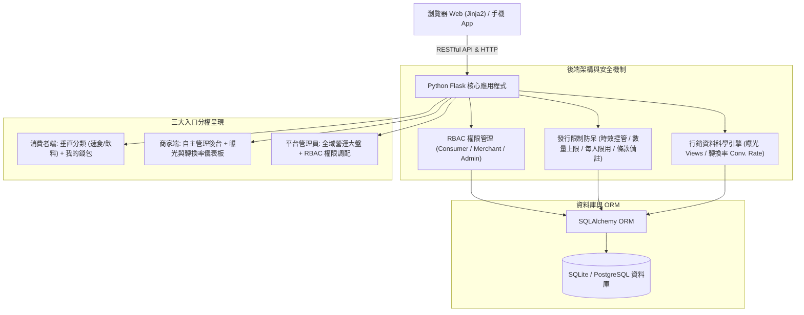

# 鈔捷徑 - 聚焦速食與飲料之優惠券核銷平台

一套基於 **Python Flask + SQLAlchemy + RESTful API** 架構打造的現代化餐飲優惠發行與智慧核銷平台。初期版面全數聚焦於「**速食**」與「**飲料**」兩大高頻次消費垂直領域，並結合「**我的錢包**」省錢記帳回饋感與商家「**行銷資料科學轉換率儀表板**」，實現消費者高黏著度與商家高留存率。

---

## 📌 系統架構圖 (Architecture Overview)



---

## 🚀 核心四大架構特色

### 1. 核心技術架構 (Tech Stack)
* **後端框架：Python Flask**  
  輕量靈活、模組化 Blueprints（認證 `auth`、消費者 `consumer`、商家 `merchant`、管理員 `admin`、API `api`），兼具開發速度與擴充性。
* **前端呈現：Flask Templates (Jinja2)**  
  結合 Bootstrap 5.3 + Bootstrap Icons + Chart.js 視覺化套件。服務端渲染讓首頁在搜尋引擎享有良好 SEO 曝光，同時頁面載入速度極快。
* **資料庫與 ORM：SQLAlchemy**  
  乾淨優雅地抽象資料模型（User, MerchantProfile, Category, Coupon, Redemption），原子化事務鎖定防超領。
* **資料交換格式：RESTful API (`/api/v1/...`)**  
  支援前端動態抽換優惠列表、非同步核銷防抖動，並為未來直接開發 iOS / Android 原生 App 提供完整底層。

### 2. 消費者端功能 (Consumer Features)
* **專屬會員登入**：消費者獨立註冊登入與狀態維護。
* **垂直分類瀏覽**：初期版面聚焦於「**速食**（漢堡/炸雞/薯條）」與「**飲料**（手搖飲/鮮果茶/拿鐵）」兩大最高頻次的民生飲食分類，培養使用者「點餐前先查優惠」的固定習慣。
* **「我的錢包」省錢追蹤**：
  * 紀錄每一次「核銷 (Redemption)」。
  * 自動加總累計省下金額（NT$），並提供榮譽稱號（小資新星 ➔ 優惠獵人 ➔ 省錢宗師）。
  * 結合 **Chart.js** 繪製每月省錢趨勢折線圖與速食/飲料佔比圓餅圖，營造極強平台成就感。

### 3. 商家端功能 (Merchant Features)
* **自主管理後台**：
  * 獨立登入與品牌檔案（Logo 網址、品牌名稱、店家簡介、門市聯絡資訊）。
  * 自行上架、編輯、暫停優惠活動。
* **商業數據儀表板 (行銷資料科學)**：
  * **曝光數 (Views)**：追蹤優惠券在前端被消費者看見的次數。
  * **點擊數 (Clicks)**：記錄深入查看優惠券詳細說明的次數。
  * **核銷數 (Redemptions)**：門市顧客實際兌換的實質轉換數。
  * **轉換率 (Conversion Rate %)**：實質呈現 `(核銷數 / 曝光數) * 100%`，讓行銷投資效益具體可視化。

### 4. 系統管理與限制防呆 (System & Constraints)
* **RBAC 權限管理**：嚴格區分 `consumer`、`merchant`、`admin` 三種角色，透過裝飾器 `@role_required` 嚴禁跨越權限。
* **優惠券發行限制機制**：
  * **時效控管**：精確至分秒之 `start_date` 與 `end_date`，未開始或過期即刻防呆失效。
  * **數量控管**：設定 `total_quantity`（總發行限量）與 `max_per_user`（單一帳號限領次數），以資料庫原子操作防止超領或惡意刷單。
  * **條款備註**：文字版使用規範（如：限內用外帶、不得與其他折價券併用、需於結帳前出示等）。

---

## 🛠️ 專案目錄結構

```text
coupon_platform/
├── app.py                      # Flask Application 工廠與進入點
├── config.py                   # 系統與環境組態設定
├── extensions.py               # SQLAlchemy 與 LoginManager 擴充套件
├── models.py                   # ORM 資料模型 (User, Merchant, Category, Coupon, Redemption)
├── decorators.py               # RBAC 角色安全防衛裝飾器
├── seed.py                     # 內建預設示範資料庫植入腳本
├── requirements.txt            # Python 相依套件
├── routes/
│   ├── __init__.py
│   ├── auth.py                 # 登入、註冊、登出模組
│   ├── consumer.py             # 消費者首頁、分類瀏覽、我的錢包、核銷動作
│   ├── merchant.py             # 商家後台、品牌檔案、優惠 CRUD、商業儀表板
│   ├── admin.py                # 平台最高管理員總控台
│   └── api.py                  # RESTful API 路由 (/api/v1/...)
├── static/
│   ├── css/
│   │   └── style.css           # 現代化美食與數據流自訂 CSS 樣式
│   └── js/
│       └── main.js             # 即時核銷 AJAX 互動、防呆檢查
└── templates/
    ├── base.html               # 全域共用佈局 (含導航列、錢包摘要、核銷 Modal)
    ├── index.html              # 首頁 (聚焦速食與飲料專區)
    ├── auth/                   # 登入與註冊頁面 (含一鍵測試代入按鈕)
    ├── consumer/               # 我的錢包、優惠券詳情
    ├── merchant/               # 商家儀表板、品牌檔案、活動表單
    └── admin/                  # 平台總控台
```

---

## 💻 快速安裝與啟動方式

### 1. 安裝 Python 相依套件
請確認電腦已安裝 Python 3.8+，並執行：
```bash
pip install -r requirements.txt
```

### 2. 植入預設展示資料 (Seed Data)
執行以下指令，系統將自動建立 SQLite 資料庫，並注入知名速食（麥當勞、肯德基、漢堡王）與飲料品牌（迷客夏、麻古茶坊、50嵐）及預設帳號：
```bash
python seed.py
```

### 3. 啟動伺服器
```bash
python app.py
```
啟動後打開瀏覽器訪問：**http://127.0.0.1:5000**

---

## 🔑 預設測試帳號清單

在登入頁面亦可直接點擊「一鍵代入測試帳號」：

| 角色 (Role) | 電子信箱 (Email) | 密碼 (Password) | 說明 |
| :--- | :--- | :--- | :--- |
| **一般消費者** | `demo@dealhub.com` | `user123` | 已具備歷史核銷紀錄，可立即檢視「我的錢包」省錢成就圖表 |
| **速食特約商家** | `mcd@dealhub.com` | `mcd123` | 麥當勞自主後台，可查看大麥克優惠券曝光數與轉換率 |
| **手搖飲料商家** | `milksha@dealhub.com` | `milksha123` | 迷客夏自主後台，可查看鮮奶手搖優惠券與行銷儀表板 |
| **平台管理員** | `admin@dealhub.com` | `admin123` | 最高權限總控台，可總覽全平台數據與動態指派 RBAC 角色 |

---

## 📡 RESTful API 端點摘要

| HTTP 方法 | 端點路徑 | 說明 |
| :--- | :--- | :--- |
| `GET` | `/api/v1/categories` | 取得垂直分類清單與各分類活躍活動數量 |
| `GET` | `/api/v1/coupons` | 查詢優惠券（支援 `?category=fastfood`、`?q=漢堡`、`?sort=savings`）並自動遞增曝光數 |
| `GET` | `/api/v1/coupons/<id>` | 取得特定優惠券詳情（包含時效、剩餘名額與條款備註） |
| `POST` | `/api/v1/coupons/<id>/redeem` | 執行即時核銷（需登入消費者，進行時效、限量與每人限用防呆驗證） |
| `GET` | `/api/v1/wallet` | 取得當前登入消費者的「我的錢包」累計省錢金額與分類佔比 |
| `GET` | `/api/v1/merchant/analytics` | 取得商家曝光數、點擊數、核銷數與整體轉換率資料 |
